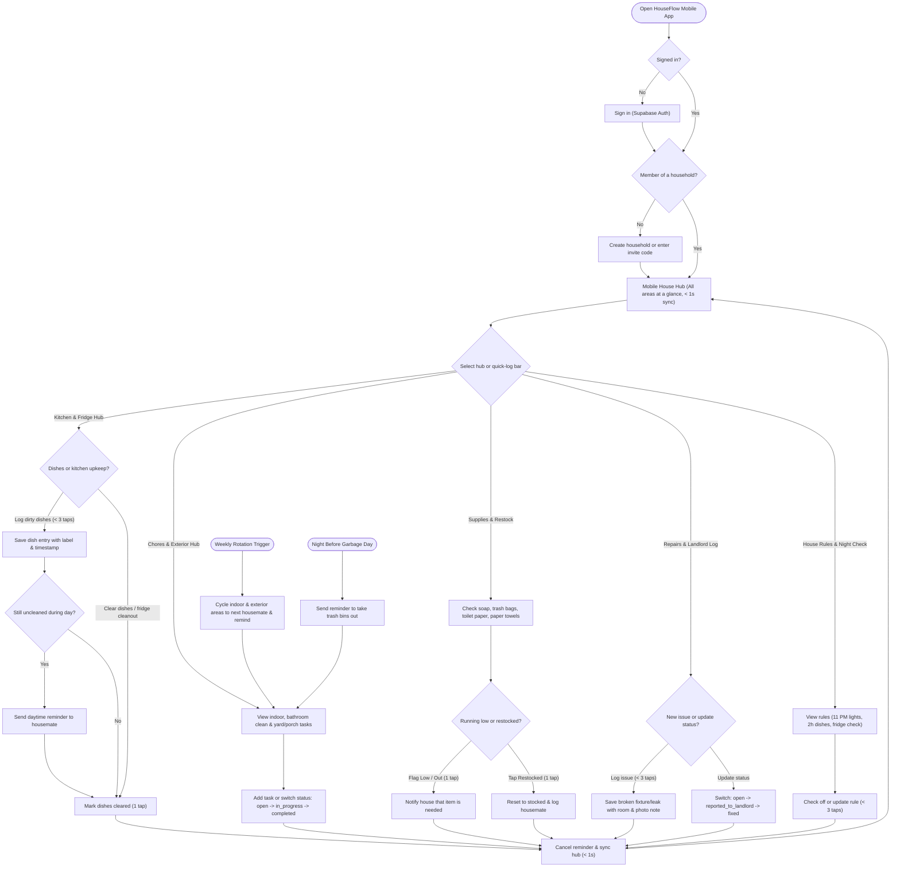

# User Flow: HouseFlow

**Related specs:** [specs/user-stories.md](../specs/user-stories.md) | [discovery/requirements.md](../discovery/requirements.md)

This flowchart shows how an off-campus student housemate uses **HouseFlow** as a mobile phone app, organized around room/maintenance hubs with real-time updates (`< 1s` sync) and automated reminders.

## End-to-End Mobile User Flow

## Flow Summary

1. **Private Household Entry (`US-8`):** Unauthenticated users sign in and either create a household or join via invite code so only verified roommates see household data.
2. **Kitchen, Sink & Fridge (`US-0`, `US-1`, `US-4`):** Logging dishes starts a daytime reminder check if uncleaned; kitchen upkeep also covers wiping the stove/microwave and fridge cleanouts before trash night.
3. **Weekly Rotation, Exterior & Garbage Night (`US-0`, `US-2`, `US-3`, `US-4`):** Housemates update chore statuses (`open` → `in_progress` → `completed`), get night-before garbage reminders, and cycle weekly through indoor rooms (including bathroom cleaning) and outdoor upkeep (porch, yard, snow/leaves).
4. **Supplies & Restock (`US-5`):** Any roommate can flag essentials like dish soap, trash bags, or toilet paper as `low` or `out` in 1 tap and clear them when restocked.
5. **Repairs & Landlord Log (`US-6`):** Roommates log leaks, broken appliances, or burned-out bulbs and track whether someone already reported them to the landlord.
6. **House Rules & Night Check (`US-7`):** Roommates check off shared agreements (such as hallway lights off by 11 PM) right from the mobile hub.
